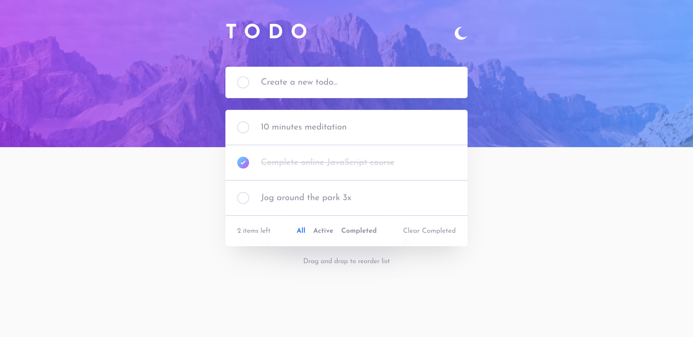

# Frontend Mentor - Todo app solution

This is a solution to
the [Todo app challenge on Frontend Mentor](https://www.frontendmentor.io/challenges/todo-app-Su1_KokOW). Frontend
Mentor challenges help you improve your coding skills by building realistic projects.

## Table of contents

- [Overview](#overview)
  - [The challenge](#the-challenge)
  - [Screenshot](#screenshot)
  - [Links](#links)
- [My process](#my-process)
  - [Built with](#built-with)
  - [What I learned](#what-i-learned)
  - [Continued development](#continued-development)
  - [Useful resources](#useful-resources)
  - [AI Collaboration](#ai-collaboration)
- [Author](#author)

## Overview

### The challenge

Users should be able to:

- View the optimal layout for the app depending on their device's screen size
- See hover states for all interactive elements on the page
- Add new todos to the list
- Mark todos as complete
- Delete todos from the list
- Filter by all/active/complete todos
- Clear all completed todos
- Toggle light and dark mode
- **Bonus**: Drag and drop to reorder items on the list

### Screenshot



### Links

- Solution URL: [GitHub Repo](https://github.com/runny-life/todo-app)
- Live Site URL: [Live](https://runny-life.github.io/todo-app/)

## My process

### Built with

- Semantic HTML5 markup
- CSS custom properties (for light and dark themes)
- Flexbox
- Mobile-first workflow
- [React](https://react.dev/) - JS library
- [Vite](https://vite.dev/) - build tool and dev server
- [SCSS Modules](https://sass-lang.com/) - scoped component styles, plus shared functions and mixins (`rem()`,
  `fluid()`, `hover`, `tablet`)
- [dnd-kit](https://docs.dndkit.com/) - drag and drop sorting
- ESLint, Prettier, Husky and lint-staged - code quality checks on every commit

### What I learned

This was my first React project built from scratch, so most of the learning was about how React thinks about data.

**State is the single source of truth.** The list of todos lives in one `useState`, and everything else is calculated
from it during rendering. For example, the filtered list and the "items left" counter are not stored separately, so they
can never get out of sync:

```jsx
const itemsLeft = todos.filter((todo) => !todo.completed).length;

const visibleTodos = todos.filter((todo) => {
  if (filter === 'active') return !todo.completed;
  if (filter === 'completed') return todo.completed;
  return true;
});
```

**State is never mutated, only replaced.** Toggling and deleting create new arrays with `map` and `filter` instead of
changing the old one:

```jsx
setTodos(todos.map((todo) => (todo.id === id ? { ...todo, completed: !todo.completed } : todo)));
```

**Themes with CSS variables and a data attribute.** All colors are CSS custom properties. The dark theme only overrides
them under `[data-theme='dark']`, so switching the theme means changing one attribute on `<html>`. The choice is saved
in `localStorage` with `useEffect`, and the initial value falls back to the system `prefers-color-scheme`.

**Avoiding the theme flash.** `useEffect` runs after the first render, which caused a short flash of the light theme on
reload. A tiny inline script in `index.html` sets `data-theme` before React starts, which fixes it.

**Other things I practiced:**

- Controlled inputs and handling form submit with `preventDefault`
- Splitting a component and passing data and callbacks through props (`TodoItem`)
- Lists with `key`
- Drag and drop with `DndContext`, `SortableContext` and `useSortable`, using a distance threshold for the mouse and a
  delay for touch, so clicks and page scrolling still work
- Making long words wrap inside a flex item (`min-width: 0` + `overflow-wrap: anywhere`)
- Writing commits in the Conventional Commits style

### Continued development

- Save the todo list in `localStorage` so it survives a page reload
- Split the styles into separate SCSS modules per component
- Add a dedicated drag handle and bring back keyboard reordering (right now the keyboard sensor is off, because it
  conflicts with the buttons inside each item)
- Add tests for the todo logic with Vitest

### Useful resources

- [React documentation](https://react.dev/) - the best place to understand state, effects and rendering.
- [dnd-kit documentation](https://docs.dndkit.com/) - explains sensors, contexts and the sortable preset.
- [MDN: prefers-color-scheme](https://developer.mozilla.org/en-US/docs/Web/CSS/@media/prefers-color-scheme) - how to
  read the system theme.

### AI Collaboration

I used Claude as a step-by-step tutor. I'm still learning React, so I asked it to explain each step while I typed the
code myself and committed after every working step.

- **How I used it:** planning the order of work, explaining new concepts (`useState`, `useEffect`, props, drag and
  drop), reviewing my code and debugging errors.
- **What worked well:** getting a reason for every line, not just a solution. Reviews of my own code also caught small
  issues, like an unused `--bg` variable and buttons without `type="button"`.
- **What I had to do myself:** compare colors and sizes with the design and the style guide, test every step in the
  browser and fix the differences. The code from an assistant is a starting point, not a guarantee.

## Author

- Website - [GitHub](https://github.com/runny-life)
- Frontend Mentor - [@runnt-life](https://www.frontendmentor.io/profile/runny-life)
